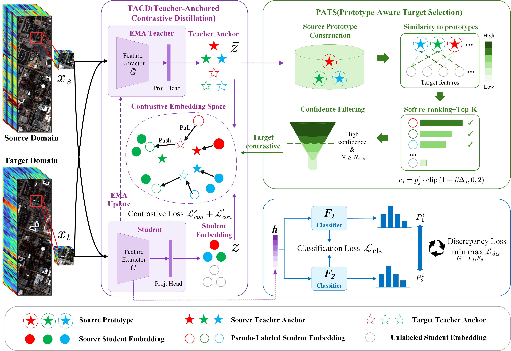

# Teacher-Anchored Prototype-Guided Domain Adaptation for Cross-Scene Hyperspectral Image Classification

> **[IEEE JSTARS 2026] Official PyTorch implementation of "Teacher-Anchored Prototype-Guided Domain Adaptation for Cross-Scene Hyperspectral Image Classification."**

> Authors: Lekang Gao and Shengwei Zhong.

[[Paper](https://ieeexplore.ieee.org/document/11664317)] [[DOI](https://doi.org/10.1109/JSTARS.2026.3726973)]

This paper is published in *IEEE Journal of Selected Topics in Applied Earth Observations and Remote Sensing* (JSTARS), 2026, pp. 1--16.

## Overview

Cross-scene hyperspectral image classification is challenging because domain shifts make target pseudo-labels unreliable, blur class boundaries, and destabilize target supervision. TAPDA addresses these problems through a coarse-to-fine unsupervised domain adaptation framework with three main components:

- **Teacher-Anchored Contrastive Distillation (TACD):** an exponential moving average (EMA) teacher provides stable embeddings, predictions, and contrastive anchors to improve intra-class compactness and inter-class separation.
- **Prototype-Aware Target Selection (PATS):** teacher confidence and source-prototype consistency are combined with class-wise Top-K mining to select reliable and balanced target samples.
- **Dual-classifier adversarial alignment:** two classifiers and discrepancy minimization reduce the source-target domain gap while preserving discriminative feature structure.

Only source labels are used during adaptation. Target labels are used exclusively for evaluation.



## Results

The following results are reported as mean ± standard deviation over ten runs:

| Transfer task | OA (%) | AA (%) | Kappa (%) |
| --- | ---: | ---: | ---: |
| Houston13 → Houston18 | **80.67 ± 0.93** | 77.73 ± 3.74 | **69.54 ± 1.36** |
| NC12 → NC13 | **94.34 ± 0.61** | **74.06 ± 5.11** | **91.24 ± 0.95** |
| UP → PC | **93.39 ± 0.37** | **93.48 ± 0.95** | **92.07 ± 0.44** |

## Environment

The current code has been tested with the following setup:

- Windows 11
- Python 3.12.11
- PyTorch 2.7.1 with CUDA 12.8
- NVIDIA GeForce RTX 5060 Ti

We recommend creating a fresh Conda environment:

```bash
conda create --name tapda -y python=3.12
conda activate tapda
pip install -r requirements.txt
```

The PyTorch packages in `requirements.txt` use the official CUDA 12.8 wheel index. If your CUDA or operating-system setup differs, install a compatible PyTorch build first and then install the remaining dependencies.

## Datasets

The hyperspectral datasets in MATLAB format can be downloaded from the dataset links provided by [MSDA-2024](https://github.com/Li-ZK/MSDA-2024), including its [Figshare mirror](https://doi.org/10.6084/m9.figshare.26761831).

Place the files under `datasets/` using the following structure:

```text
datasets/
├── Houston/
│   ├── Houston13.mat
│   ├── Houston13_7gt.mat
│   ├── Houston18.mat
│   └── Houston18_7gt.mat
├── YRD/
│   ├── yrd_nc12.mat
│   ├── yrd_nc12_7gt.mat
│   ├── yrd_nc13.mat
│   └── yrd_nc13_7gt.mat
└── Pavia/
    ├── paviaU.mat
    ├── paviaU_gt_7.mat
    ├── pavia.mat
    └── pavia_gt_7.mat
```

The three benchmarks contain seven shared classes. The default source split randomly selects 180 labeled samples per class for each of ten preset seeds.

## Training

Each task has a dedicated entry script. The default arguments reproduce the task-specific TAPDA settings used in the paper and evaluate the ensemble of the two classifiers.

For Houston13 → Houston18:

```bash
python houston13218.py --gpu 0
```

For NC12 → NC13:

```bash
python nc122nc13.py --gpu 0
```

For Pavia University → Pavia Center:

```bash
python up2pc.py --gpu 0
```

The main task-specific settings are:

| Setting | Houston13 → Houston18 | NC12 → NC13 | UP → PC |
| --- | ---: | ---: | ---: |
| Input patch | 7 × 7 × 48 | 3 × 3 × 270 | 9 × 9 × 102 |
| Epochs / batch size | 50 / 32 | 50 / 32 | 50 / 32 |
| Target TACD max. weight | 0.20 | 0.25 | 0.20 |
| Confidence threshold | 0.75 → 0.88 | 0.75 → 0.88 | 0.75 → 0.85 |
| Prototype score weight | 0.10 | 0.15 | 0.05 |
| BNM max. weight | Disabled | Disabled | 0.15 |

All command-line options can be inspected with, for example:

```bash
python houston13218.py --help
```

Weights & Biases logging is optional and disabled by default. Pass `--log_results` only after configuring your own W&B account.

## Outputs

Training logs and evaluation results are written locally to:

```text
runs/<dataset_name>/<run_name>/
├── args.json
├── command.txt
├── train.log
├── dataset_00_result.json
├── ...
└── summary.json
```

`summary.json` contains the mean and standard deviation of OA, AA, kappa, per-class accuracy, and the individual/ensemble classifier results across the ten runs.

## Citation

If you find this project useful in your research, please consider citing our paper:

```bibtex
@article{gao2026teacher,
  author  = {Gao, Lekang and Zhong, Shengwei},
  title   = {Teacher-Anchored Prototype-Guided Domain Adaptation for Cross-Scene Hyperspectral Image Classification},
  journal = {IEEE Journal of Selected Topics in Applied Earth Observations and Remote Sensing},
  year    = {2026},
  pages   = {1--16},
  doi     = {10.1109/JSTARS.2026.3726973}
}
```

## Acknowledgements

This implementation was developed with reference to [MSDA-2024](https://github.com/Li-ZK/MSDA-2024). We thank its authors for making their code publicly available. The presentation of this repository also follows the clear release structure used by [PCADA-2025](https://github.com/Leap-luohaiyang/PCADA-2025).
